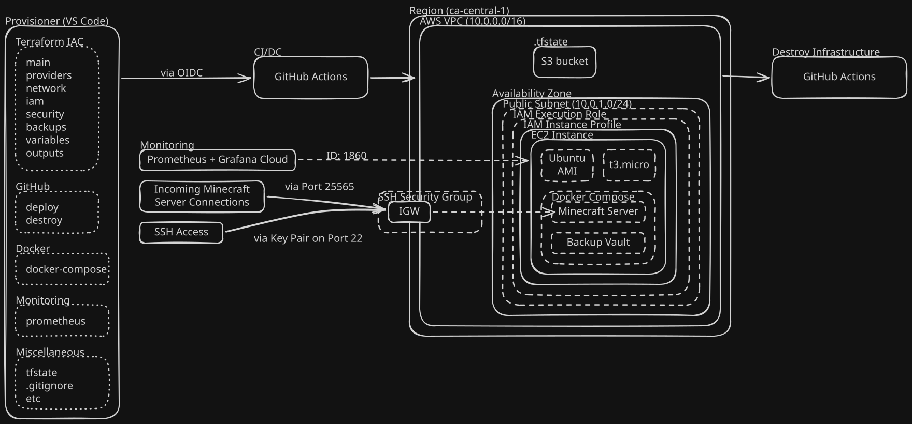
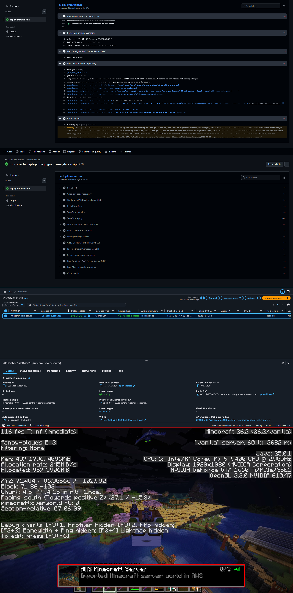
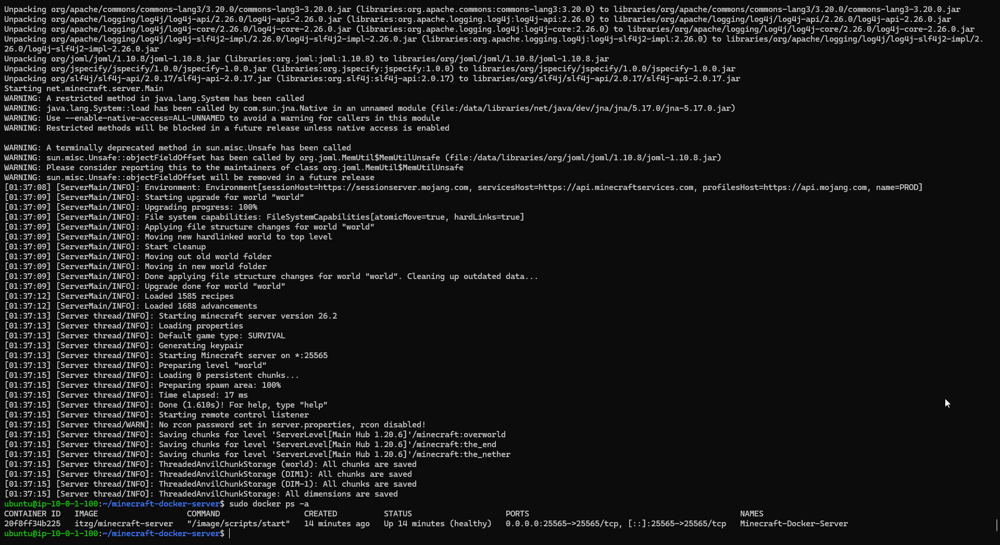

<a id="readme-top"></a>
# Automated AWS Game Server & Monitoring Infrastructure via Terraform Case Study

[](https://aws.amazon.com/)
[](https://www.docker.com/)
[](https://github.com/features/actions)
[](https://grafana.com/)
[](https://www.linux.org/)
[](https://prometheus.io/)
[](https://www.terraform.io/)

I recently built an automated AWS game server deployment using Terraform, Linux shell automation, containerized application delivery via GitHub Actions, and EC2 instance monitoring using Prometheus and Grafana Cloud with the assistance of AI. I will go more in detail with the infrastructure built along with future improvements below.

---

## Table of Contents
- [Overview](#overview)
- [Tech Stack](#tech-stack)
- [Key Features & Infrastructure Decisions](#key-features--infrastructure-decisions)
- [Project Structure](#project-structure)
- [How to Deploy](#how-to-deploy)
- [Verification & Screenshots](#verification--screenshots)
- [Production Roadmap](#production-roadmap-future-improvements)
- [Development Approach & AI Usage](#development-approach--ai-usage)

---

## Overview

This application stack is deployed onto a single resource-constrained host (`t3.micro`) with a swap file configured as the primary instance-type with a (`t3.medium`) instance for further testing. To maintain optimal performance and prevent host crashes, compute and visualization layers are strictly decoupled.


<p align="right">(<a href="#readme-top">back to top</a>)</p>

---

## Tech Stack
- **IAC:** Terraform
- **Cloud platform:** AWS
- **CI/CD pipeline:** GitHub Actions
- **Container platform:** Docker Compose
- **Monitoring:** Prometheus and Grafana Cloud
<p align="right">(<a href="#readme-top">back to top</a>)</p>

---

## Key Features & Infrastructure Decisions

1. **Terraform Automation:** Declarative application deployment.
2. **Cloud Monitoring:** Grafana Cloud was utilized over a local instance to offload resource constrained EC2 hardware resources.
3. **Linux Swapfile:** Used to assist in booting the Minecraft server due to low memory constraints.
4. **Layer 4 TCP Routing:** Bypassed Layer 7 HTTP/S Ingress controllers due to raw socket traffic requirements for Minecraft (25565/TCP) and Terraria (7777/TCP).
<p align="right">(<a href="#readme-top">back to top</a>)</p>

---

## Project Structure

```text
├── main.tf
├── providers.tf
├── network.tf
├── iam.tf
├── security.tf
├── variables.tf
├── outputs.tf
├── backups.tf
├── .github/workflows
│   └── deploy.yml
│   └── destroy.yml
├── monitoring/
│   └── prometheus.yml
└── README.md
```
<p align="right">(<a href="#readme-top">back to top</a>)</p>

---
## How to Deploy

The provisioning and application deployment is fully automated via GitHub Actions as the CI/CD pipeline:

1. **Infrastructure & Application Launch:** Push to the `main` branch to trigger `.github/workflows/deploy.yml`.
2. **Local Validation (Dry Run):**
``` bash
   # Validate Terraform configurations locally
   terraform init && terraform plan

   # Validate Docker Compose configuration locally
   docker compose config
```

<p align="right">(<a href="#readme-top">back to top</a>)</p>

---

## Verification & Screenshots

### AWS Deployment & Health Topology
*The red highlighted sections are separate screenshots of the successful GitHub Action, AWS EC2 console, and in-game screenshot connection.*


### Terminal Verification



<p align="right">(<a href="#readme-top">back to top</a>)</p>

---

## Production Roadmap (Future Improvements)

- **Offline Development:** 
	- **Backups:** A side-car container (itzg/mc-backup) on home lab hardware was used for backups instead of the initial AWS backup vault.
	- **Local Monitoring Stack:** The same local monitoring (Grafana, Prometheus) was also built on homelab hardware with log scraping capabilities using *Grafana Alloy* & *Loki* (ID: 13639).
	- **Access Control:** Tailscale side-car for access control.
- **FinOps:** Migrate the EC2 instance to ECS + Fargate, implement an ELB, and configure CloudWatch actions to shut down the container when not in-use.
- **Idempotent Infrastructure:** The initial intent for this project was to automate an imported world save, however with a configuration tool absent (i.e. Ansible) due to project scope I settled with a single-deployment only SSH import of the world save. An idempotent solution will be implemented to maintain a persistent world.
<p align="right">(<a href="#readme-top">back to top</a>)</p>

---

## Development Approach & AI Usage

This project was built and executed using a combination between an **AI-assisted workflow** (leveraging LLMs as a collaborative pair-programmer) and free online courses.
- **Architecture & Ownership:** All system design choices (initial backup solution, OIDC authentication bridge, AWS API authentication, secrets management, networking, etc.) were directed human-in-the-loop.
- **AI Utility:** Coding exercises, Terraform templating, cross-referencing documentation, syntax review, troubleshooting CI/CD pipeline errors.
<p align="right">(<a href="#readme-top">back to top</a>)</p>

---